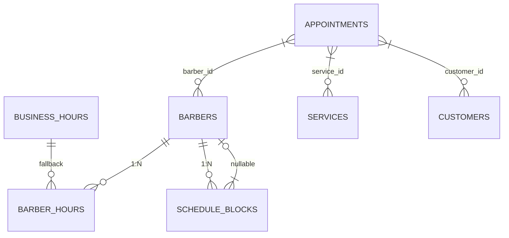

# Esquema de Base de Datos - Galindo Barbershop v1.0.0

> **Versión:** 1.0 (Basado en migraciones 001-009)
> **Proyecto Supabase:** `fithxgprfwkfptgjhqcy`
> **Fecha:** 2026-11-20

---

## Resumen de Tablas

| Tabla | Propósito | Extensiones |
|-------|-----------|-------------|
| `profiles` | Perfiles extendidos de auth.users | pgcrypto, uuid-ossp |
| `customers` | Datos adicionales de clientes | citext |
| `barbers` | Barberos/profesionales | - |
| `services` | Catálogo de servicios | - |
| `barber_services` | Relación barbero-servicio | - |
| `business_hours` | Horario general del local | - |
| `barber_hours` | Horarios individuales por barbero | - |
| `schedule_blocks` | Bloqueos (descansos, vacaciones) | - |
| `appointments` | Citas programadas | btree_gist |
| `appointment_events` | Auditoría de cambios de cita | - |
| `walk_ins` | Atenciones sin cita previa | - |
| `payments` | Pagos por citas/walk-ins | - |
| `loyalty_programs` | Configuración programa fidelidad | - |
| `loyalty_transactions` | Movimientos de puntos | - |
| `reviews` | Reseñas y calificaciones | - |
| `notifications` | Sistema multicanal | - |
| `notification_preferences` | Preferencias por usuario | - |
| `barber_attendance` | Control asistencia | - |
| `barber_absences` | Ausencias planificadas | - |
| `audit_logs` | Log auditoría general | - |
| `settings` | Configuraciones dinámicas | - |

---

## Diagramas Entidad-Relación (Mermaid)

### Núcleo: Usuarios, Barberos, Servicios, Citas

```mermaid
erDiagram
    PROFILES ||--o{ CUSTOMERS : "1:0..1"
    PROFILES ||--o{ BARBERS : "1:0..1 (profile_id)"
    PROFILES ||--o{ APPOINTMENTS : "via customers"
    PROFILES ||--o{ APPOINTMENT_EVENTS : "actor"
    PROFILES ||--o{ NOTIFICATIONS : "recipient"
    PROFILES ||--o{ NOTIFICATION_PREFERENCES : "1:1"
    PROFILES ||--o{ AUDIT_LOGS : "actor"

    CUSTOMERS ||--o{ APPOINTMENTS : "1:N"
    CUSTOMERS ||--o{ WALK_INS : "1:N"
    CUSTOMERS ||--o{ PAYMENTS : "1:N"
    CUSTOMERS ||--o{ LOYALTY_TRANSACTIONS : "1:N"
    CUSTOMERS ||--o{ REVIEWS : "1:N"

    BARBERS ||--o{ APPOINTMENTS : "1:N"
    BARBERS ||--o{ WALK_INS : "1:N"
    BARBERS ||--o{ BARBER_HOURS : "1:N"
    BARBERS ||--o{ SCHEDULE_BLOCKS : "1:N"
    BARBERS ||--o{ BARBER_SERVICES : "1:N"
    BARBERS ||--o{ BARBER_ATTENDANCE : "1:N"
    BARBERS ||--o{ BARBER_ABSENCES : "1:N"
    BARBERS ||--o{ REVIEWS : "1:N"

    SERVICES ||--o{ APPOINTMENTS : "1:N"
    SERVICES ||--o{ WALK_INS : "1:N"
    SERVICES ||--o{ BARBER_SERVICES : "1:N"
    SERVICES ||--o{ REVIEWS : "1:N"

    APPOINTMENTS ||--o{ APPOINTMENT_EVENTS : "1:N"
    APPOINTMENTS ||--o{ PAYMENTS : "1:N"
    APPOINTMENTS ||--o{ LOYALTY_TRANSACTIONS : "1:N"
    APPOINTMENTS ||--o| REVIEWS : "1:0..1"

    WALK_INS ||--o{ PAYMENTS : "1:N"

    LOYALTY_PROGRAMS ||--o{ LOYALTY_TRANSACTIONS : "1:N"

    SCHEDULE_BLOCKS }|--o{ BARBERS : "N:1 (nullable)"

    BUSINESS_HOURS .. BARBER_HOURS : "fallback si no existe"
```

### Horarios y Disponibilidad



---

## Definición de Tablas (DDL)

### 1. profiles (Core Auth)

```sql
CREATE TABLE public.profiles (
    id UUID PRIMARY KEY REFERENCES auth.users(id) ON DELETE CASCADE,
    full_name VARCHAR(120) NOT NULL,
    phone VARCHAR(20),
    avatar_url TEXT,
    role VARCHAR(20) NOT NULL DEFAULT 'client'
        CHECK (role IN ('client', 'barber', 'admin', 'receptionist', 'owner')),
    is_active BOOLEAN NOT NULL DEFAULT TRUE,
    metadata JSONB DEFAULT '{}'::jsonb,
    created_at TIMESTAMPTZ NOT NULL DEFAULT NOW(),
    updated_at TIMESTAMPTZ NOT NULL DEFAULT NOW()
);
```

**RLS:** Usuario ve su perfil, Staff ve todos, Usuario actualiza su perfil (no role), Staff actualiza todos.

---

### 2. customers

```sql
CREATE TABLE public.customers (
    profile_id UUID PRIMARY KEY REFERENCES public.profiles(id) ON DELETE CASCADE,
    dni VARCHAR(12) UNIQUE,
    birth_date DATE,
    preferences JSONB DEFAULT '{}'::jsonb,
    notes TEXT,
    marketing_consent BOOLEAN NOT NULL DEFAULT FALSE,
    marketing_consent_at TIMESTAMPTZ,
    created_at TIMESTAMPTZ NOT NULL DEFAULT NOW(),
    updated_at TIMESTAMPTZ NOT NULL DEFAULT NOW()
);
```

---

### 3. barbers

```sql
CREATE TABLE public.barbers (
    id UUID PRIMARY KEY DEFAULT gen_random_uuid(),
    profile_id UUID UNIQUE REFERENCES public.profiles(id) ON DELETE SET NULL,
    display_name VARCHAR(120) NOT NULL,
    slug VARCHAR(120) UNIQUE NOT NULL,
    bio TEXT,
    phone VARCHAR(20),
    email CITEXT,
    avatar_url TEXT,
    specialization TEXT[],
    years_experience SMALLINT CHECK (years_experience >= 0),
    hire_date DATE,
    is_active BOOLEAN NOT NULL DEFAULT TRUE,
    sort_order SMALLINT NOT NULL DEFAULT 0,
    created_at TIMESTAMPTZ NOT NULL DEFAULT NOW(),
    updated_at TIMESTAMPTZ NOT NULL DEFAULT NOW()
);
```

---

### 4. services

```sql
CREATE TABLE public.services (
    id UUID PRIMARY KEY DEFAULT gen_random_uuid(),
    name VARCHAR(100) NOT NULL,
    slug VARCHAR(100) UNIQUE NOT NULL,
    description TEXT,
    price NUMERIC(10,2) NOT NULL CHECK (price >= 0),
    duration_min INTEGER NOT NULL CHECK (duration_min > 0),
    buffer_min INTEGER NOT NULL DEFAULT 0 CHECK (buffer_min >= 0),
    category VARCHAR(50) NOT NULL DEFAULT 'general',
    image_url TEXT,
    is_active BOOLEAN NOT NULL DEFAULT TRUE,
    is_public BOOLEAN NOT NULL DEFAULT TRUE,
    requires_confirmation BOOLEAN NOT NULL DEFAULT FALSE,
    sort_order SMALLINT NOT NULL DEFAULT 0,
    metadata JSONB DEFAULT '{}'::jsonb,
    created_at TIMESTAMPTZ NOT NULL DEFAULT NOW(),
    updated_at TIMESTAMPTZ NOT NULL DEFAULT NOW()
);
```

---

### 5. barber_services

```sql
CREATE TABLE public.barber_services (
    barber_id UUID NOT NULL REFERENCES public.barbers(id) ON DELETE CASCADE,
    service_id UUID NOT NULL REFERENCES public.services(id) ON DELETE CASCADE,
    duration_override_min INTEGER CHECK (duration_override_min > 0),
    price_override NUMERIC(10,2) CHECK (price_override >= 0),
    is_active BOOLEAN NOT NULL DEFAULT TRUE,
    sort_order SMALLINT NOT NULL DEFAULT 0,
    created_at TIMESTAMPTZ NOT NULL DEFAULT NOW(),
    updated_at TIMESTAMPTZ NOT NULL DEFAULT NOW(),
    PRIMARY KEY (barber_id, service_id)
);
```

---

### 6. business_hours

```sql
CREATE TABLE public.business_hours (
    id UUID PRIMARY KEY DEFAULT gen_random_uuid(),
    weekday SMALLINT NOT NULL CHECK (weekday BETWEEN 0 AND 6),
    start_time TIME NOT NULL,
    end_time TIME NOT NULL,
    is_open BOOLEAN NOT NULL DEFAULT TRUE,
    break_start TIME,
    break_end TIME,
    is_break_active BOOLEAN NOT NULL DEFAULT FALSE,
    created_at TIMESTAMPTZ NOT NULL DEFAULT NOW(),
    updated_at TIMESTAMPTZ NOT NULL DEFAULT NOW(),
    UNIQUE (weekday),
    CHECK (end_time > start_time)
);
```

---

### 7. barber_hours

```sql
CREATE TABLE public.barber_hours (
    id UUID PRIMARY KEY DEFAULT gen_random_uuid(),
    barber_id UUID NOT NULL REFERENCES public.barbers(id) ON DELETE CASCADE,
    weekday SMALLINT NOT NULL CHECK (weekday BETWEEN 0 AND 6),
    start_time TIME NOT NULL,
    end_time TIME NOT NULL,
    is_open BOOLEAN NOT NULL DEFAULT TRUE,
    break_start TIME,
    break_end TIME,
    is_break_active BOOLEAN NOT NULL DEFAULT FALSE,
    created_at TIMESTAMPTZ NOT NULL DEFAULT NOW(),
    updated_at TIMESTAMPTZ NOT NULL DEFAULT NOW(),
    UNIQUE (barber_id, weekday),
    CHECK (end_time > start_time)
);
```

---

### 8. schedule_blocks

```sql
CREATE TABLE public.schedule_blocks (
    id UUID PRIMARY KEY DEFAULT gen_random_uuid(),
    barber_id UUID REFERENCES public.barbers(id) ON DELETE CASCADE,
    title VARCHAR(200) NOT NULL,
    reason VARCHAR(500),
    starts_at TIMESTAMPTZ NOT NULL,
    ends_at TIMESTAMPTZ NOT NULL,
    is_recurring BOOLEAN NOT NULL DEFAULT FALSE,
    recurrence_rule TEXT,
    recurrence_end DATE,
    color VARCHAR(7) DEFAULT '#EF4444',
    created_by UUID REFERENCES public.profiles(id) ON DELETE SET NULL,
    created_at TIMESTAMPTZ NOT NULL DEFAULT NOW(),
    updated_at TIMESTAMPTZ NOT NULL DEFAULT NOW(),
    CHECK (ends_at > starts_at)
);
```

---

### 9. appointments (Tabla crítica)

```sql
CREATE TYPE public.appointment_status AS ENUM (
    'pending', 'confirmed', 'in_progress', 'completed',
    'cancelled', 'rescheduled', 'no_show', 'walk_in'
);

CREATE TABLE public.appointments (
    id UUID PRIMARY KEY DEFAULT gen_random_uuid(),
    customer_id UUID NOT NULL REFERENCES public.customers(profile_id) ON DELETE CASCADE,
    barber_id UUID NOT NULL REFERENCES public.barbers(id) ON DELETE CASCADE,
    service_id UUID NOT NULL REFERENCES public.services(id) ON DELETE CASCADE,
    starts_at TIMESTAMPTZ NOT NULL,
    ends_at TIMESTAMPTZ NOT NULL,
    status public.appointment_status NOT NULL DEFAULT 'pending',
    price_snapshot NUMERIC(10,2) NOT NULL CHECK (price_snapshot >= 0),
    duration_snapshot_min INTEGER NOT NULL CHECK (duration_snapshot_min > 0),
    service_name_snapshot VARCHAR(100) NOT NULL,
    barber_name_snapshot VARCHAR(120) NOT NULL,
    notes TEXT,
    cancellation_reason TEXT,
    cancelled_by UUID REFERENCES public.profiles(id) ON DELETE SET NULL,
    cancelled_at TIMESTAMPTZ,
    confirmed_by UUID REFERENCES public.profiles(id) ON DELETE SET NULL,
    confirmed_at TIMESTAMPTZ,
    completed_at TIMESTAMPTZ,
    source VARCHAR(20) NOT NULL DEFAULT 'app' CHECK (source IN ('app', 'walk_in', 'phone', 'whatsapp', 'admin')),
    idempotency_key VARCHAR(100) UNIQUE,
    metadata JSONB DEFAULT '{}'::jsonb,
    created_at TIMESTAMPTZ NOT NULL DEFAULT NOW(),
    updated_at TIMESTAMPTZ NOT NULL DEFAULT NOW(),
    CHECK (ends_at > starts_at),
    CHECK (duration_snapshot_min = EXTRACT(EPOCH FROM (ends_at - starts_at))/60)
);

-- EXCLUSIÓN GiST (Anti-doble-reserva) - REQUISITO CRÍTICO
ALTER TABLE public.appointments ADD CONSTRAINT no_overlapping_appointments
EXCLUDE USING GIST (
    barber_id WITH =,
    tsrange(starts_at, ends_at) WITH &&
) WHERE (status IN ('pending', 'confirmed', 'in_progress'));
```

---

### 10. appointment_events (Auditoría inmutable)

```sql
CREATE TABLE public.appointment_events (
    id UUID PRIMARY KEY DEFAULT gen_random_uuid(),
    appointment_id UUID NOT NULL REFERENCES public.appointments(id) ON DELETE CASCADE,
    old_status public.appointment_status,
    new_status public.appointment_status NOT NULL,
    actor_id UUID NOT NULL REFERENCES public.profiles(id) ON DELETE CASCADE,
    actor_role VARCHAR(20) NOT NULL,
    reason TEXT,
    metadata JSONB DEFAULT '{}'::jsonb,
    created_at TIMESTAMPTZ NOT NULL DEFAULT NOW()
);
```

---

### 11. walk_ins (Sin cita previa)

```sql
CREATE TABLE public.walk_ins (
    id UUID PRIMARY KEY DEFAULT gen_random_uuid(),
    customer_id UUID REFERENCES public.customers(profile_id) ON DELETE SET NULL,
    barber_id UUID NOT NULL REFERENCES public.barbers(id) ON DELETE CASCADE,
    service_id UUID NOT NULL REFERENCES public.services(id) ON DELETE CASCADE,
    starts_at TIMESTAMPTZ NOT NULL DEFAULT NOW(),
    ends_at TIMESTAMPTZ,
    status public.appointment_status NOT NULL DEFAULT 'walk_in',
    price_snapshot NUMERIC(10,2) NOT NULL CHECK (price_snapshot >= 0),
    duration_snapshot_min INTEGER NOT NULL CHECK (duration_snapshot_min > 0),
    notes TEXT,
    payment_method VARCHAR(20) CHECK (payment_method IN ('cash', 'yape', 'plin', 'card', 'other')),
    payment_amount NUMERIC(10,2) CHECK (payment_amount >= 0),
    payment_confirmed BOOLEAN NOT NULL DEFAULT FALSE,
    created_by UUID REFERENCES public.profiles(id) ON DELETE SET NULL,
    created_at TIMESTAMPTZ NOT NULL DEFAULT NOW(),
    updated_at TIMESTAMPTZ NOT NULL DEFAULT NOW(),
    CHECK (ends_at IS NULL OR ends_at > starts_at)
);
```

---

### 12. payments

```sql
CREATE TYPE public.payment_method AS ENUM ('cash', 'yape', 'plin', 'card', 'transfer', 'other');
CREATE TYPE public.payment_status AS ENUM ('pending', 'confirmed', 'partial', 'refunded', 'cancelled');

CREATE TABLE public.payments (
    id UUID PRIMARY KEY DEFAULT gen_random_uuid(),
    appointment_id UUID REFERENCES public.appointments(id) ON DELETE SET NULL,
    walk_in_id UUID REFERENCES public.walk_ins(id) ON DELETE SET NULL,
    customer_id UUID NOT NULL REFERENCES public.customers(profile_id) ON DELETE CASCADE,
    amount NUMERIC(10,2) NOT NULL CHECK (amount >= 0),
    method public.payment_method NOT NULL,
    status public.payment_status NOT NULL DEFAULT 'pending',
    reference VARCHAR(100),
    notes TEXT,
    confirmed_by UUID REFERENCES public.profiles(id) ON DELETE SET NULL,
    confirmed_at TIMESTAMPTZ,
    receipt_number VARCHAR(50) UNIQUE,
    receipt_pdf_url TEXT,
    metadata JSONB DEFAULT '{}'::jsonb,
    created_at TIMESTAMPTZ NOT NULL DEFAULT NOW(),
    updated_at TIMESTAMPTZ NOT NULL DEFAULT NOW(),
    CHECK (appointment_id IS NOT NULL OR walk_in_id IS NOT NULL)
);
```

---

### 13. loyalty_programs

```sql
CREATE TABLE public.loyalty_programs (
    id UUID PRIMARY KEY DEFAULT gen_random_uuid(),
    name VARCHAR(100) NOT NULL,
    description TEXT,
    points_per_sol NUMERIC(5,2) NOT NULL DEFAULT 1.00 CHECK (points_per_sol > 0),
    points_per_visit INTEGER NOT NULL DEFAULT 0 CHECK (points_per_visit >= 0),
    min_points_redeem INTEGER NOT NULL DEFAULT 100 CHECK (min_points_redeem > 0),
    points_value_sol NUMERIC(10,4) NOT NULL DEFAULT 0.01 CHECK (points_value_sol > 0),
    expires_months INTEGER NOT NULL DEFAULT 12 CHECK (expires_months > 0),
    is_active BOOLEAN NOT NULL DEFAULT TRUE,
    tiers JSONB DEFAULT '[]'::jsonb,
    created_at TIMESTAMPTZ NOT NULL DEFAULT NOW(),
    updated_at TIMESTAMPTZ NOT NULL DEFAULT NOW()
);
```

---

### 14. loyalty_transactions

```sql
CREATE TYPE public.loyalty_transaction_type AS ENUM (
    'earned_purchase', 'earned_visit', 'earned_bonus', 'earned_referral',
    'redeemed', 'expired', 'adjusted', 'refunded'
);

CREATE TABLE public.loyalty_transactions (
    id UUID PRIMARY KEY DEFAULT gen_random_uuid(),
    customer_id UUID NOT NULL REFERENCES public.customers(profile_id) ON DELETE CASCADE,
    program_id UUID NOT NULL REFERENCES public.loyalty_programs(id) ON DELETE CASCADE,
    appointment_id UUID REFERENCES public.appointments(id) ON DELETE SET NULL,
    payment_id UUID REFERENCES public.payments(id) ON DELETE SET NULL,
    type public.loyalty_transaction_type NOT NULL,
    points INTEGER NOT NULL,
    balance_after INTEGER NOT NULL CHECK (balance_after >= 0),
    description TEXT,
    expires_at TIMESTAMPTZ,
    created_by UUID REFERENCES public.profiles(id) ON DELETE SET NULL,
    created_at TIMESTAMPTZ NOT NULL DEFAULT NOW()
);
```

---

### 15. reviews

```sql
CREATE TABLE public.reviews (
    id UUID PRIMARY KEY DEFAULT gen_random_uuid(),
    customer_id UUID NOT NULL REFERENCES public.customers(profile_id) ON DELETE CASCADE,
    barber_id UUID REFERENCES public.barbers(id) ON DELETE SET NULL,
    service_id UUID REFERENCES public.services(id) ON DELETE SET NULL,
    appointment_id UUID UNIQUE REFERENCES public.appointments(id) ON DELETE SET NULL,
    rating SMALLINT NOT NULL CHECK (rating BETWEEN 1 AND 5),
    title VARCHAR(200),
    comment TEXT,
    is_public BOOLEAN NOT NULL DEFAULT TRUE,
    is_verified BOOLEAN NOT NULL DEFAULT FALSE,
    response TEXT,
    responded_by UUID REFERENCES public.profiles(id) ON DELETE SET NULL,
    responded_at TIMESTAMPTZ,
    metadata JSONB DEFAULT '{}'::jsonb,
    created_at TIMESTAMPTZ NOT NULL DEFAULT NOW(),
    updated_at TIMESTAMPTZ NOT NULL DEFAULT NOW()
);
```

---

### 16. notifications

```sql
CREATE TYPE public.notification_channel AS ENUM ('in_app', 'email', 'whatsapp', 'sms', 'push');
CREATE TYPE public.notification_status AS ENUM ('pending', 'sent', 'delivered', 'read', 'failed', 'cancelled');

CREATE TABLE public.notifications (
    id UUID PRIMARY KEY DEFAULT gen_random_uuid(),
    recipient_id UUID NOT NULL REFERENCES public.profiles(id) ON DELETE CASCADE,
    channel public.notification_channel NOT NULL DEFAULT 'in_app',
    type VARCHAR(50) NOT NULL,
    title VARCHAR(200) NOT NULL,
    body TEXT NOT NULL,
    data JSONB DEFAULT '{}'::jsonb,
    status public.notification_status NOT NULL DEFAULT 'pending',
    priority SMALLINT NOT NULL DEFAULT 0,
    scheduled_for TIMESTAMPTZ,
    sent_at TIMESTAMPTZ,
    delivered_at TIMESTAMPTZ,
    read_at TIMESTAMPTZ,
    error_message TEXT,
    external_id VARCHAR(100),
    created_at TIMESTAMPTZ NOT NULL DEFAULT NOW(),
    updated_at TIMESTAMPTZ NOT NULL DEFAULT NOW()
);
```

---

### 17. notification_preferences

```sql
CREATE TABLE public.notification_preferences (
    profile_id UUID PRIMARY KEY REFERENCES public.profiles(id) ON DELETE CASCADE,
    in_app_enabled BOOLEAN NOT NULL DEFAULT TRUE,
    email_enabled BOOLEAN NOT NULL DEFAULT TRUE,
    whatsapp_enabled BOOLEAN NOT NULL DEFAULT FALSE,
    sms_enabled BOOLEAN NOT NULL DEFAULT FALSE,
    push_enabled BOOLEAN NOT NULL DEFAULT FALSE,
    appointment_reminders BOOLEAN NOT NULL DEFAULT TRUE,
    appointment_confirmations BOOLEAN NOT NULL DEFAULT TRUE,
    appointment_changes BOOLEAN NOT NULL DEFAULT TRUE,
    payment_receipts BOOLEAN NOT NULL DEFAULT TRUE,
    promotions BOOLEAN NOT NULL DEFAULT FALSE,
    reviews_requests BOOLEAN NOT NULL DEFAULT TRUE,
    quiet_hours_start TIME,
    quiet_hours_end TIME,
    timezone VARCHAR(50) NOT NULL DEFAULT 'America/Lima',
    updated_at TIMESTAMPTZ NOT NULL DEFAULT NOW()
);
```

---

### 18. barber_attendance

```sql
CREATE TYPE public.attendance_status AS ENUM ('present', 'late', 'absent', 'justified', 'on_break', 'left_early');

CREATE TABLE public.barber_attendance (
    id UUID PRIMARY KEY DEFAULT gen_random_uuid(),
    barber_id UUID NOT NULL REFERENCES public.barbers(id) ON DELETE CASCADE,
    date DATE NOT NULL,
    scheduled_start TIME NOT NULL,
    scheduled_end TIME NOT NULL,
    actual_start TIMESTAMPTZ,
    actual_end TIMESTAMPTZ,
    status public.attendance_status NOT NULL DEFAULT 'absent',
    notes TEXT,
    recorded_by UUID REFERENCES public.profiles(id) ON DELETE SET NULL,
    created_at TIMESTAMPTZ NOT NULL DEFAULT NOW(),
    updated_at TIMESTAMPTZ NOT NULL DEFAULT NOW(),
    UNIQUE (barber_id, date)
);
```

---

### 19. barber_absences

```sql
CREATE TYPE public.absence_type AS ENUM ('vacation', 'sick_leave', 'personal', 'training', 'other');

CREATE TABLE public.barber_absences (
    id UUID PRIMARY KEY DEFAULT gen_random_uuid(),
    barber_id UUID NOT NULL REFERENCES public.barbers(id) ON DELETE CASCADE,
    type public.absence_type NOT NULL,
    start_date DATE NOT NULL,
    end_date DATE NOT NULL,
    reason TEXT,
    approved_by UUID REFERENCES public.profiles(id) ON DELETE SET NULL,
    approved_at TIMESTAMPTZ,
    is_approved BOOLEAN NOT NULL DEFAULT FALSE,
    creates_schedule_blocks BOOLEAN NOT NULL DEFAULT TRUE,
    created_at TIMESTAMPTZ NOT NULL DEFAULT NOW(),
    updated_at TIMESTAMPTZ NOT NULL DEFAULT NOW(),
    CHECK (end_date >= start_date)
);
```

---

### 20. audit_logs

```sql
CREATE TYPE public.audit_action AS ENUM (
    'create', 'update', 'delete', 'login', 'logout', 'password_change',
    'role_change', 'permission_change', 'data_export', 'data_import',
    'config_change', 'payment_confirm', 'payment_refund',
    'appointment_status_change', 'bulk_operation'
);

CREATE TABLE public.audit_logs (
    id UUID PRIMARY KEY DEFAULT gen_random_uuid(),
    actor_id UUID REFERENCES public.profiles(id) ON DELETE SET NULL,
    actor_role VARCHAR(20),
    action public.audit_action NOT NULL,
    entity_type VARCHAR(50) NOT NULL,
    entity_id UUID,
    old_data JSONB,
    new_data JSONB,
    metadata JSONB DEFAULT '{}'::jsonb,
    severity VARCHAR(10) NOT NULL DEFAULT 'info' CHECK (severity IN ('debug', 'info', 'warning', 'error', 'critical')),
    created_at TIMESTAMPTZ NOT NULL DEFAULT NOW()
);
```

---

### 21. settings (Configuraciones dinámicas)

```sql
CREATE TABLE public.settings (
    key VARCHAR(100) PRIMARY KEY,
    value JSONB NOT NULL,
    value_type VARCHAR(20) NOT NULL DEFAULT 'json' CHECK (value_type IN ('string', 'number', 'boolean', 'json', 'array')),
    category VARCHAR(50) NOT NULL DEFAULT 'general',
    description TEXT,
    is_public BOOLEAN NOT NULL DEFAULT FALSE,
    is_editable BOOLEAN NOT NULL DEFAULT TRUE,
    validation JSONB,
    updated_by UUID REFERENCES public.profiles(id) ON DELETE SET NULL,
    updated_at TIMESTAMPTZ NOT NULL DEFAULT NOW()
);
```

**Configuraciones críticas (DEMO):**

| Key | Valor DEMO | Tipo | Público | Descripción |
|-----|------------|------|---------|-------------|
| `booking.slot_interval_min` | 30 | number | ✅ | Intervalo entre franjas |
| `booking.min_advance_hours` | 1 | number | ✅ | Antelación mínima |
| `booking.max_advance_days` | 30 | number | ✅ | Días máximos futuro |
| `booking.initial_status` | "pending" | string | ✅ | Estado inicial reserva |
| `booking.pending_blocks_availability` | true | boolean | ✅ | Si pending bloquea |
| `booking.confirmed_blocks_availability` | true | boolean | ✅ | Si confirmed bloquea |
| `booking.allow_client_cancel` | true | boolean | ✅ | Cliente puede cancelar |
| `booking.min_cancel_hours` | 2 | number | ✅ | Horas mínimas cancelar |
| `booking.max_cancellations_per_month` | 0 | number | ✅ | Límite mensual (0=sin) |

---

## Vistas Útiles

### `v_appointments_full`
Citas con datos completos (cliente, barbero, servicio) para listados.

### `v_barber_daily_schedule`
Horarios efectivos por barbero (individual o fallback a business_hours).

---

## Extensiones Requeridas

| Extensión | Propósito | Migración |
|-----------|-----------|-----------|
| `pgcrypto` | `gen_random_uuid()`, `crypt()` | 001 |
| `uuid-ossp` | `uuid_generate_v4()` | 001 |
| `btree_gist` | Exclusion constraint GiST | 001 |
| `citext` | Emails case-insensitive | 001 |
| `pg_trgm` | Búsquedas trigram (futuro) | 001 |

---

## Funciones RPC Principales

| Función | Parámetros | Descripción |
|---------|------------|-------------|
| `get_available_slots(p_service_id, p_barber_id, p_date)` | service, barber, date | Franjas disponibles calculadas server-side |
| `book_appointment(p_service_id, p_barber_id, p_starts_at, p_note, p_idempotency_key)` | service, barber, hora, nota, key | **Atómica**: reserva + snapshots + auditoría |
| `cancel_appointment(p_appointment_id, p_reason)` | id, motivo | Cancela validando políticas + libera slot |
| `update_appointment_status(p_appointment_id, p_new_status, p_reason)` | id, estado, motivo | Staff/barbero actualiza estado + auditoría |
| `handle_new_user()` | (trigger) | Crea profile + customer + prefs en registro Auth |

---

## Triggers

| Trigger | Tabla | Evento | Función |
|---------|-------|--------|---------|
| `on_auth_user_created` | `auth.users` | AFTER INSERT | `handle_new_user()` |
| `set_updated_at` | Todas con `updated_at` | BEFORE UPDATE | Auto-update timestamp |

---

## Índices Críticos

| Tabla | Índices Clave |
|-------|---------------|
| `appointments` | `(customer_id)`, `(barber_id, starts_at)`, `(status)`, `(starts_at)`, `(idempotency_key)` |
| `appointment_events` | `(appointment_id)`, `(actor_id)`, `(created_at)` |
| `schedule_blocks` | `(barber_id, starts_at, ends_at)`, global time |
| `barber_services` | `(barber_id)`, `(service_id)`, `(is_active)` |
| `barber_hours` | `(barber_id, weekday)` |
| `payments` | `(customer_id)`, `(appointment_id)`, `(walk_in_id)` |
| `loyalty_transactions` | `(customer_id)`, `(appointment_id)`, `(created_at)` |
| `notifications` | `(recipient_id)`, `(status)`, `(scheduled_for)` |

---

## Notas de Seguridad

1. **RLS habilitada** en TODAS las tablas `public.*`
2. **Políticas por rol**: client, barber, admin, receptionist, owner
3. **Funciones SECURITY DEFINER** solo para RPCs críticas con `search_path = public` fijo
4. **No secrets** en base de datos (keys en variables de entorno)
5. **Auditoría inmutable** en `appointment_events` y `audit_logs`
6. **Snapshots inmutables** en appointments (price, duration, names)
7. **Exclusión GiST** previene doble reserva concurrente a nivel DB
8. **Idempotency key** en bookings evita duplicados por reintentos de red